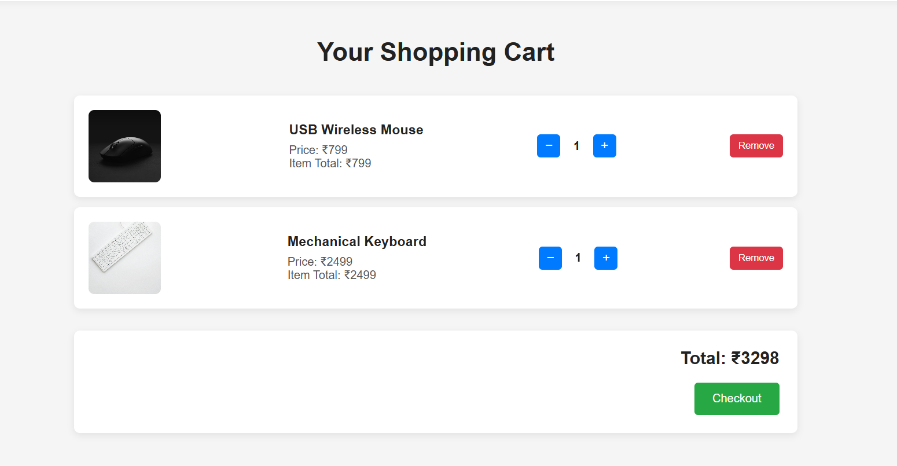
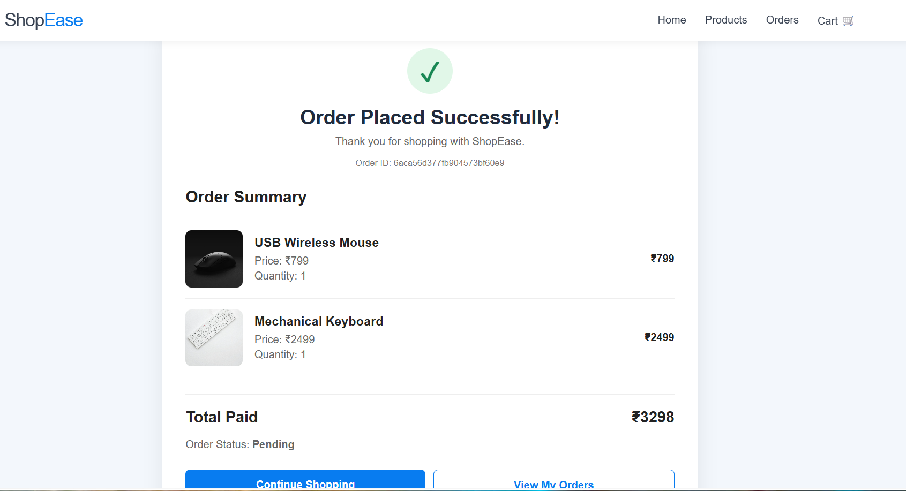
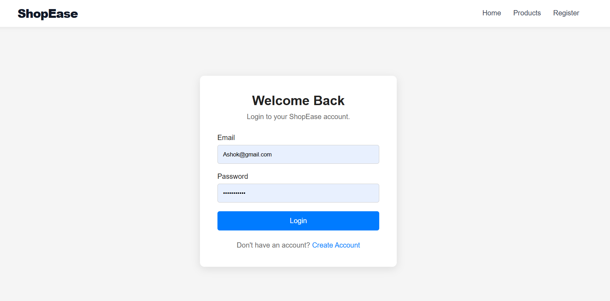

# ShopEase — E-commerce Store

ShopEase is a full-stack e-commerce web application developed as part of my CodeAlpha internship project. It allows users to browse products, register and log in, manage their shopping cart, place orders, view order history, and cancel pending orders.

## Live Demo

- **Frontend:** [https://shopease-frontend-bk08.onrender.com]
- **Backend API:** https://codealpha-ecommercestore-25bt.onrender.com

## Features

- User registration and login
- Password hashing using bcrypt
- JWT-based authentication
- Product listing and product management APIs
- Add products to the shopping cart
- Update and remove cart items
- Place orders and view order history
- View individual order details
- Cancel pending orders
- Restore product stock when an order is cancelled
- MongoDB Atlas database integration
- Responsive frontend design

## Tech Stack

**Frontend**
- HTML
- CSS
- JavaScript

**Backend**
- Node.js
- Express.js
- REST API

**Database**
- MongoDB Atlas
- Mongoose

**Authentication and Security**
- JSON Web Tokens (JWT)
- bcryptjs
- dotenv

**Deployment and Version Control**
- Render
- Git and GitHub

## Project Structure

```text
CodeAlpha_EcommerceStore/
├── backend/
│   ├── config/
│   ├── controllers/
│   ├── middleware/
│   ├── models/
│   ├── routes/
│   └── server.js
├── frontend/
│   ├── index.html
│   ├── login.html
│   ├── register.html
│   ├── cart.html
│   ├── orders.html
│   ├── order-success.html
│   ├── style.css
│   └── script.js
├── .env
├── .gitignore
├── package.json
└── README.md
```

## Run Locally

### Prerequisites

- Node.js and npm
- A MongoDB Atlas account or MongoDB connection URI
- Git

### Installation

1. Clone the repository:

   ```bash
   git clone https://github.com/shiva78-ui/CodeAlpha_EcommerceStore.git
   ```

2. Open the project directory:

   ```bash
   cd CodeAlpha_EcommerceStore
   ```

3. Install dependencies:

   ```bash
   npm install
   ```

4. Create a `.env` file in the project root:

   ```env
   MONGODB_URI=your_mongodb_connection_string
   JWT_SECRET=your_strong_random_secret
   ```

   Replace the placeholders with your own values. Never publish real credentials.

5. Start the backend:

   ```bash
   npm start
   ```

6. Open the deployed frontend URL in your browser. For local frontend testing, serve the `frontend` directory using a local development server.

## API Routes

| Method | Endpoint | Purpose |
|---|---|---|
| GET | `/api/products` | Retrieve products |
| `/api/auth` | Authentication routes | Registration and login |
| `/api/cart` | Cart routes | Manage shopping cart |
| `/api/orders` | Order routes | Place and manage orders |

The authentication, cart, and order routes may require a valid JWT token, depending on the endpoint.

## Environment Variables

| Variable | Purpose |
|---|---|
| `MONGODB_URI` | MongoDB connection string |
| `JWT_SECRET` | Secret used for JWT signing and verification |

## Security Notes

- Keep `.env` out of version control.
- Never expose database credentials or JWT secrets.
- Use appropriate authentication and authorization checks for protected APIs.
- Restrict database network access where feasible.

## Project Objective

The objective of this project is to gain practical experience in full-stack web development, REST API design, database integration, authentication, order management, GitHub collaboration, and cloud deployment.

## Author

Developed as a CodeAlpha internship project.
## Screenshots

### 1. Homepage


### 2. Shopping Cart


### 3. Order History


### 4. Login Page


